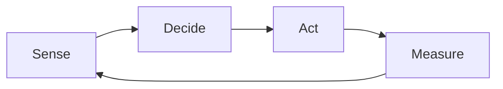

# Evolution Loop

The four-phase loop (Sense, Decide, Act, Measure) driving
`sks-evolve`: signal sources, the one-signal-one-action mapping,
width-vs-depth recursion, fitness scoring, parity rules, and the
multi-judge panel. Read before running a cycle; the body carries
the cycle procedure and its stops.

## The loop

1. **Sense** — mine recorded experience for evolution signals: memory
   entries, session history, correction traces, repeated pitfalls, token-cost
   observations, eval failures — the results skills produced in the wild
   (retrospective what following each skill actually yielded: landed commits,
   PR bodies, defects that recurred despite the rule; every gap between
   prescribed and produced is a signal) — and, equally, external sources: an
   upstream release or fix, a paper's model, a sibling catalog's convention.
   Signals are the mutation source. Read-only:
   never edit memories or sessions to make a signal go away.
2. **Decide** — select the next evolution autonomously. One signal maps to one
action: author a new skill (`sks-edit` references/skill-authoring/guide.md),
curate an existing skill or profile (`sks-curate`), run a batch catalog/profile
refresh (`sks-selfupdate`), author a profile distribution (`sks-curate`), update
memory, conventions (`AGENTS.md`), cron, harness, or config by their own update
rules, or fan out independent targets (`sks-delegate`, `sks-async`, `sks-
swarm`). Token efficiency is a first-class selection pressure: a change is worth
landing only when it measurably reduces load cost or failure rate. Recursion has
two shapes: width — fan out k candidates in parallel (`sks-async`) and compose
from the shared pool; depth — chain k refine steps carrying accumulated
evidence. Choose width to explore, depth to refine. 3. **Act** — execute through
the delegated skill; never hand-write the product here. Absorb externals where
they beat internals (an upstream fix, a paper's model). Each candidate change is
one variation. 4. **Measure** — score fitness: token cost delta, failure-rate
delta, eval deltas. Selection keeps what measurably improved; the fitness
results re-rank the signal backlog for the next cycle. Judge parity (judge,
report, and run share executor, model, and seed): baseline and candidate are
graded under identical conditions — same assertion set, same model, same harness
— or the delta is void. Post the flip diff, not just the totals; a true-to-false
flip is a regression. For judgment-laden changes (wording, structure,
curations), optionally widen the judge: fan out one `sks-adversarial` sandbox
per (agent CLI, model) pair via `sks-async` — claude-code, codex, and hermes
hosting different vendors' models (Opus, GPT, GLM, DeepSeek, Qwen) — each
returning an independent keep/revert verdict on the same diff. Diversity must be
vendor- or harness-deep: N instances of one model are one judge, not a panel.
Judges are provenance-blind: hand them the artifacts without the originating
harness, and picking the base output is a valid outcome. Record the verdicts
(majority + strongest dissent) in the issue comment beside the numbers; a
majority revert overrides favorable self-measurement.
